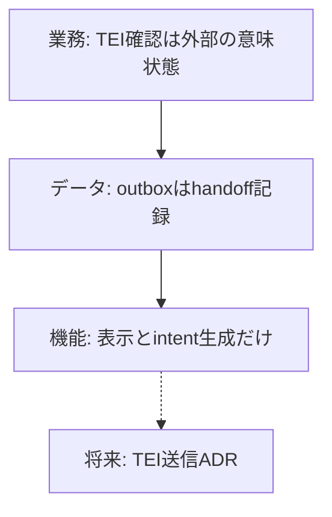

# ADR-0110: 三要素分析による上流設計の再編成とepistemic handoffの境界

- Status: Accepted（2026-11-01）
- Date: 2026-11-01
- Deciders: Maintainer（PoC優先の指示にもとづく再編成）
- Scope: `01_Plans/adr/`、epistemic review、COGNITIVE-ASSOC-01、Issue #3346
- Related: `ADR-0067`（三要素分析法）、`ADR-0089`（価値の正本）、`ADR-0101`（TEI transport）、`ADR-0109`（T8 retrieval-only）、Issue #3346

## 価値への寄与

V3「レビュー」とP-03「人間レビューの追跡」に寄与する。TEIの確認状態をSUIの人間レビューと混ぜず、handoffの境界をデータ面で固定する。SafeMode、未レビュー非公開、`human_reviewed`、proposal-onlyは緩和しない。

## Context

PoCを先に進めた結果、上位の設計が追いつかず、次の課題が同じ場所で止まっていた。

1. `EpistemicReviewIntent` を既存のReviewEventへ永続化するか決まらず、#3346が止まっていた。
2. TEIの`confirmed`とSUIの`human_reviewed`の関係が曖昧で、確認状態の自動昇格を避ける境界がデータ面に無かった。
3. T8の証拠（T5/T6/T7）が無いまま、retrieval-onlyのPoCと学習順位付けの位置づけが混ざっていた。
4. 三要素ゲートは、網羅率が遡及適用で飽和し、データ行が文書分割の話へ退化し、落ちた判断の記録が無いという弱点を抱えていた。

ADR-0067はADR-0089にSupersededされている。三要素の表をすべてのADRへ必須とする運用は戻さない。今回は、境界・権限・transportを変える判断に限って三要素を使い、上の4課題を横断的に整理する。

## Decision

### 1. 三要素の再配置

| 要素 | 上位での役割 | 今回の決定 | 他要素への制約 |
|---|---|---|---|
| 業務 | 誰が確認し、何を根拠に次へ進むか | TEIの確認は外部の意味状態であり、SUIの人間レビューではない。SUIの`human_reviewed`はSUIの利用者が自分の操作でだけ設定する。 | 機能: 自動昇格のAPIを作らない。データ: `human_reviewed`へ写すフィールドを作らない。 |
| データ | 何を保存し、何を境界の外に置くか | `EpistemicReviewIntent`はTEIへのhandoff記録としてoutboxへ置く。ReviewEventとDocumentV1には入れない。保存するのは識別子とfingerprintだけとする。 | 業務: 監査はoutboxの件数と操作で追う。機能: ReviewEventの意味をTEI確認へ広げない。 |
| 機能 | どの操作とAPIで境界を守るか | パネルは表示、queue、一括確認プレビュー、intent生成まで。outboxは端末内で上限付き。TEIへの送信APIはまだ作らない。 | 業務: 人間が明示的に操作する。データ: 本文を保存しない。 |

### 2. #3346の要件を組み替える

ReviewEventへの永続化adapterは作らない。TEIの確認をReviewEventへ入れると、`markReviewed`がカードの`human_reviewed`を意味する既存契約と衝突するためである。

代わりに、次の境界を固定する。

- outboxはTEIへのhandoff待ちの記録であり、SUIの確認済み状態ではない。
- outboxの消去は利用者が行う。文書の保存や共有の対象にしない。
- TEIへ送る処理を追加するときは、送信先、認証、監査、再送、重複排除を新しいADRで決める。
- 実利用者によるqualificationは、外部協力者の確保を完了条件にしない。ADR-0089の証拠階層に従い、T2/T3の範囲で記録する。T1が無いことを理由に実装を止めない。

### 3. T8の位置づけ

ADR-0109の`retrieval_only`を維持する。学習順位付け、埋め込み、外部推論は、T5のProceedとT6/T7の結果が揃うまで実装しない。T8の証拠不足は研究課題であり、プロダクトの実装を止める条件にしない。

### 4. 上流工程の横断的な修正

- 三要素を使う範囲は、データ境界、権限、transport、監査を変える判断に限る。軽微な実装や文言の変更には求めない。
- データ行には、実在するファイル、契約、テストのどれかを書く。書けない場合は、文書分割の話で埋めず、`N/A`と理由を書く。
- ゲートの有効性は、節の網羅率ではなく、判断を変えた件数と落とした件数で見る。今回の#3346の組み替えを、最初の「判断を変えた記録」とする。
- ProposedのままのADRは、具体的な圧力が生じるまで実装しない。すべてを同時に決めることはしない。
- 能力カナリア（既知の不良な設計判断をゲートが落とすか）は未実装である。次にゲートを変更するときに、既知の不良例を1件追加する。

### 5. 判断の変更記録

| 課題 | 再編成前 | 再編成後 |
|---|---|---|
| #3346の永続化 | `EpistemicReviewIntent`を既存ReviewEventへ書く | outboxをhandoff記録とし、ReviewEventへ書かない |
| 実利用者qualification | 外部利用者3人以上を完了条件にする | T2/T3の範囲で記録し、外部協力者の確保を完了条件にしない |
| T8の証拠 | 証拠が無いとretrieval-onlyも止める | retrieval-onlyは実装し、学習順位付けだけをT5/T6/T7まで止める |
| 三要素ゲートの測り方 | 節の網羅率で見る | 判断を変えた件数と落とした件数で見る |

## Three-Element Verification（自己適用）

| 次元 | このADRでの主張 | 他次元への制約 |
|---|---|---|
| 業務 | TEIの確認とSUIの人間レビューを分ければ、確認状態の自動昇格を防げる | 機能: 自動昇格APIを作らない。データ: ReviewEventへ写さない。 |
| データ | outboxはhandoff記録であり、DocumentV1とReviewEventの外に置く | 業務: 監査はoutboxで追う。機能: outboxの上限と消去をUIに出す。 |
| 機能 | 表示とintent生成だけを実装し、送信は別ADRに送る | 業務: 人間の明示操作を残す。データ: 本文を保存しない。 |

## Consequences

- #3346は、ReviewEvent adapterを要件から外して閉じる。outboxの実装は残る。
- TEI連携の送信APIは未実装のままである。必要になった時点で新しいADRを起こす。
- 三要素ゲートの弱点は、範囲を絞るだけでは解消しない。能力カナリアは未実装であり、次回のゲート変更で追加する。
- Proposed ADRの棚卸しは、圧力のあるものから進める。すべてを一度に採否しない。
- SafeMode、未レビュー非公開、`human_reviewed`、proposal-onlyの境界は変わらない。
