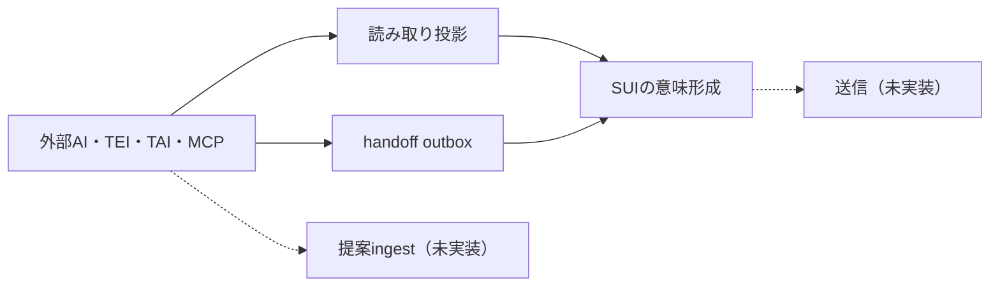

# ADR-0111: 上位課題を意味保全型の外部認知インターフェースとして接続する

- Status: Accepted（2026-11-01）
- Date: 2026-11-01
- Deciders: Maintainer（上位課題の設定とPoC優先の指示にもとづく）
- Scope: `01_Plans/adr/`、`ROADMAP.md`、MCP、TEI epistemic projection、COGNITIVE-ASSOC-01、agent連携
- Related: `ADR-0089`、`ADR-0093`、`ADR-0101`、`ADR-0102`、`ADR-0103`、`ADR-0108`、`ADR-0109`、`ADR-0110`

## 価値への寄与

V3「レビュー」とV4「共有と学習」に寄与する。外部のAI、TEI、TAI、MCPクライアントを接続しても、出典・異論・保留・人間の判断権を失わないための上位の境界を定める。SafeMode、未レビュー非公開、`human_reviewed`、proposal-onlyは緩和しない。

## Context

直近の分析は、それぞれ別の課題として進んできた。

- COGNITIVE-ASSOC-01 T8は、認知支援の候補をどこまで製品へ持ち込むかを扱う。T5/T6/T7の結果が無いため、学習順位付けは止めている（`ADR-0109`）。
- TEI epistemic projectionは、外部の意味状態をSUIで表示する。確認状態を`human_reviewed`へ写さず、outboxをhandoff境界とする（`ADR-0101`、`ADR-0110`）。
- TAI・agent連携は、提案のingestを書込み経路として扱う。必要性が観測されるまで作らない（`ADR-0108`）。
- MCPは、レビュー済みの文脈を読み取り専用で返す（`ADR-0093`、`ADR-0103`）。

これらは、どれも「外部の認知主体とSUIの意味をどう受け渡すか」という同じ問題の変形である。しかし上位の問いが無いため、境界の判断が個別のADRへ分散し、次のリスクが残る。

1. 接続ごとに権限・監査・失効の扱いが変わり、安全不変条件の抜けが生じる。
2. 読み取り、handoff、提案、送信のどれを実装したかが一覧できない。
3. 証拠の階層と実装の順序が結びつかず、T8の証拠不足が実装全体の停止に見える。

## Decision

### 1. 上位課題

プロダクトの上位課題を、**意味保全型の外部認知インターフェース**とする。

> 外部のAI、TEI、TAI、MCPクライアントがSUIの意味形成へ関与するとき、出典・異論・保留・人間の判断権を失わず、接続の方向と権限を一箇所で説明できるようにする。

これは機能の追加ではなく、既存の接続判断を同じ枠で扱うための上位の問いである。価値の定義（`ADR-0089`）を置き換えない。

### 2. 接続の四類型

| 類型 | 方向 | 現在の実装 | 権限への効果 | 境界 |
|---|---|---|---|---|
| 読み取り投影 | 外部 → SUIの投影を読む | MCPの2ツール、TEI投影の表示 | なし | レビュー済みだけ。未レビューは件数のみ。 |
| handoff | 外部の意味状態 → SUIのoutbox | TEI intentのoutbox | なし（SUIの確認済みにしない） | 識別子とfingerprintだけ。本文を保存しない。 |
| 提案ingest | 外部 → SUIの提案 | 未実装（`ADR-0108`） | 提案のみ。自動適用しない | 受信面の認可、監査、undoを新しいADRで決める。 |
| 送信 | SUI → 外部 | 未実装 | なし | 送信先、認証、監査、再送を新しいADRで決める。 |

四類型は、同じ境界判定を共有する。類型ごとに新しい安全モデルを作らない。

### 3. 境界の宣言規則

新しい接続を設計するときは、次の5点をADRに書く。

1. **方向**: 読み取り、handoff、提案ingest、送信のどれか。
2. **データ class**: レビュー済み、未レビュー、秘密、personaのどれを扱うか。
3. **権限への効果**: なし、提案、人間の確認のどれか。`human_reviewed`を自動で設定する経路は認めない。
4. **証拠の階層**: T1、T2、T3、技術測定のどれか。無い場合は「無し」と書く。
5. **可逆性**: 取り消し、outboxの消去、再送の重複排除のどれで戻せるか。

5点が揃わない接続は実装しない。既存の接続は、このADRの表へ追記してから変更する。

### 4. 実装順序

1. 読み取り投影を維持する。MCPは読み取り専用のままにする。
2. handoffはoutboxまでとする。TEIへの送信は、必要が生じるまで作らない。
3. 提案ingestは、`ADR-0108`の再検討条件が揃うまで作らない。
4. 送信は、handoffの運用で具体的な必要が観測された時点で新しいADRを起こす。
5. 認知支援の学習順位付けは、T5/T6/T7の結果が揃うまで作らない。retrieval-onlyは維持する。

### 5. 直近の分析課題との接続

| 分析課題 | 上位課題での位置 | 現在の判断 | 次の判断 |
|---|---|---|---|
| COGNITIVE-ASSOC-01 T8 | 読み取り投影の候補生成 | retrieval-onlyを維持（`ADR-0109`） | T5のProceed、T6/T7の結果 |
| TEI epistemic projection | 読み取り投影とhandoff | 表示とoutboxまで（`ADR-0101`、`ADR-0110`） | TEI送信の必要が生じたとき |
| TAI・agentの提案ingest | 提案ingest | 作らない（`ADR-0108`） | 具体的な入力例、認可、監査、undo |
| MCPの読み取り | 読み取り投影 | 読み取り専用（`ADR-0093`） | 変更しない |
| 実利用者qualification | 証拠の階層 | T2/T3で記録（`ADR-0110`） | 実利用の観察 |

### 6. 上流工程の横断的な扱い

- 接続の判断は、このADRの四類型と5点の宣言へ集約する。個別のIssueやPoCで新しい境界を作らない。
- ProposedのADRは、この上位課題への圧力が生じたものから採否する。すべてを同時に決めない。
- 三要素の表は、境界・権限・transportを変える判断にだけ使う（`ADR-0110`）。
- T8の証拠不足は、学習順位付けの停止条件であり、読み取り投影とhandoffの停止条件ではない。

### 7. 上位課題の完了条件

次の4点が揃ったとき、この上位課題は一段落したとみなす。

1. 現在の接続がすべて四類型のどれかに写され、表に無い接続が残っていない。
2. 新しい接続のADRが、5点の宣言をすべて持つ。
3. 未レビューの読み取り露出と、`human_reviewed`の自動設定が、テストで否定されている。
4. T8、TEI送信、TAIの提案ingestのそれぞれに、次に判断する条件が書かれている。

### 8. 境界を支えるテスト

| 境界 | テスト | 固定する内容 |
|---|---|---|
| 読み取り投影（agent） | `test_unreviewed_card_text_is_withheld_from_agents`、`test_only_reviewed_text_and_allowed_structure_reach_agents` | 未レビューの本文とIDを返さない |
| 読み取り投影（派生route） | `test_derived_read_routes_stay_closed_to_agents` | TEI投影を含む派生routeをagentへ開かない |
| handoff（outbox） | `epistemic_review_outbox.test.ts` の allowlist・型検証テスト | カード本文・ナラティブを保存せず、改ざんされたbindingを拒否する |
| handoff（パネル） | `epistemic_review_panel.spec.ts` | intentを保存せず、`human_reviewed`へ書き込まない |
| 読み取り投影（tenant） | `test_binding_of_another_tenant_is_not_served` | 他テナントのartifactを返さない |
| 認知支援（retrieval-only） | `affinity_candidates.test.ts`、`RelatedCandidatesPanel.test.ts` | 決定論的で、関係や統合を自動適用しない |

## Three-Element Verification（自己適用）

| 次元 | このADRでの主張 | 他次元への制約 |
|---|---|---|
| 業務 | 外部接続の判断を一つの上位課題へ集めれば、接続ごとの安全の抜けを減らせる | 機能: 四類型と5点の宣言をADRに要求する。データ: 類型ごとのデータclassを書く。 |
| データ | 読み取り、handoff、提案、送信で扱うデータを分ける | 業務: 権限への効果を類型ごとに確認する。機能: 未レビューと秘密の扱いを接続ごとに決める。 |
| 機能 | 読み取り投影とoutboxを先に維持し、送信とingestを急がない | 業務: 人間の判断を待つ。データ: 可逆性の手段を書く。 |

## Consequences

- 外部接続の設計は、このADRの表と5点の宣言を起点にできる。個別のPoCは、表のどこを進めたかを説明できる。
- 読み取り投影とhandoffは現状のまま動く。TEI送信、提案ingest、学習順位付けは未実装のままである。
- 接続の一覧はこのADRで維持する。管理台帳は作らない。
- 能力カナリアは未実装のままである。次に三要素ゲートを変更するときに追加する。
- SafeMode、未レビュー非公開、`human_reviewed`、proposal-onlyの境界は変わらない。
